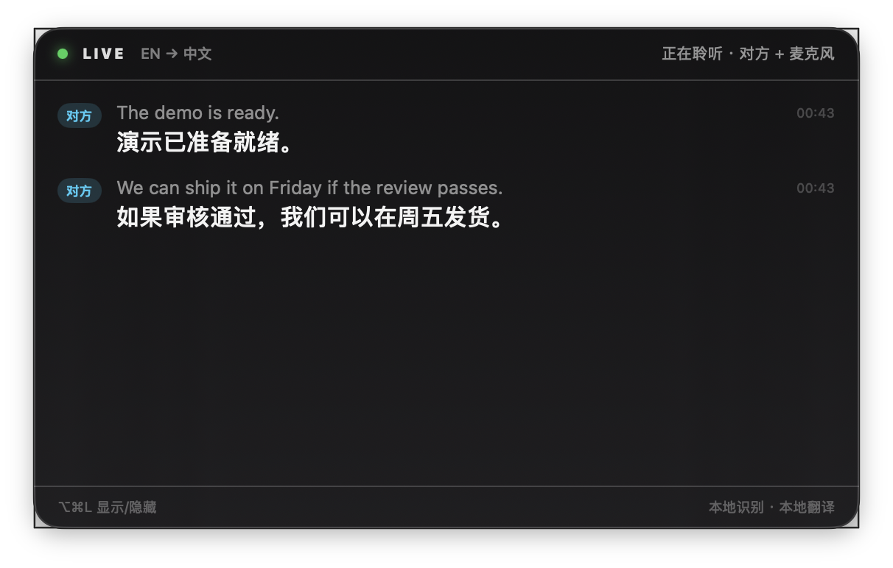
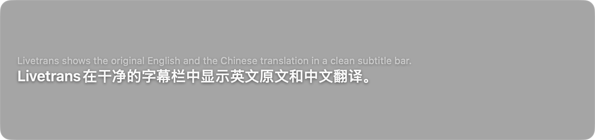
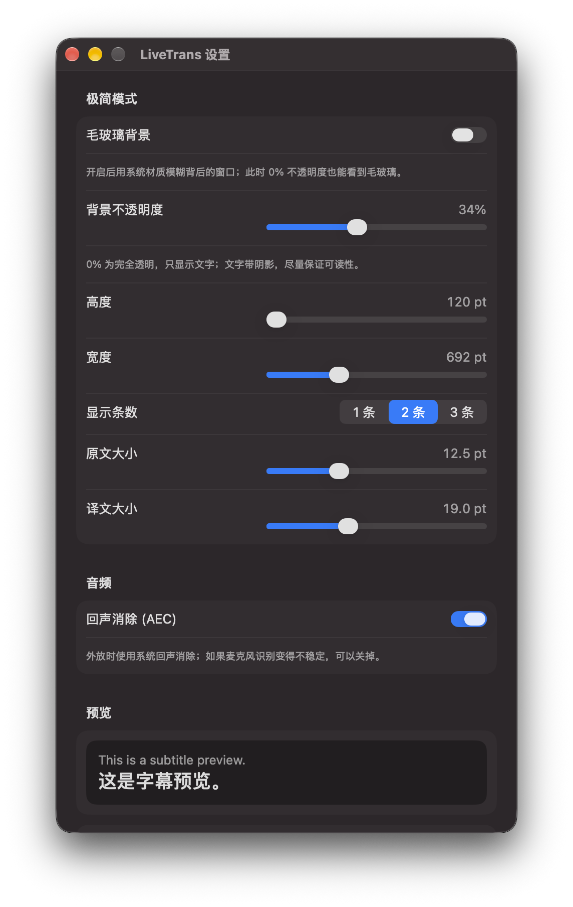
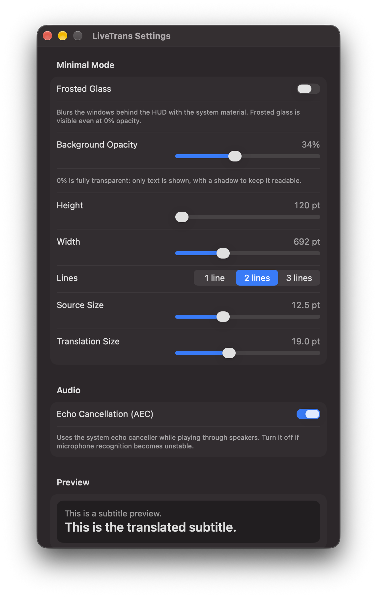

# LiveTrans

macOS 上的实时英译中 HUD：同时听**系统声音（对方）**和**麦克风（我）**，用 Apple 原生框架做流式识别 + 本地翻译，结果显示在一个始终置顶的半透明面板里。

两种显示模式：

**完整模式**（带状态、双方标签、时间戳）



**极简模式**（只有原文和译文，底部字幕条；示例为 35% 背景，默认 0% 全透明）



**设置**（极简模式 + 音频；中文）



**Settings**（English locale）



## 功能

- 系统声音 + 麦克风双路采集，分别标注「对方 / 我」
- 流式英文识别（`SpeechAnalyzer` + `SpeechTranscriber`），partial 实时刷新
- 本地英译中（`Translation.framework`），不联网、不需要 API key
- 始终置顶 HUD：跨 Space、全屏 App 上方、不抢焦点、可拖动
- 两种模式：完整面板 / 极简字幕条（`⌥⌘M` 切换，选择会记住）
- 极简模式只保留原文 + 译文，长条默认贴屏幕底部居中
- 背景默认 **0%（全透明）**，只显示文字；可在独立设置里调不透明度、宽度、高度、条数和字号
- **毛玻璃背景** toggle：开启后用系统材质模糊背后的窗口，0% 不透明度也能看到磨砂
- 菜单栏控制：显示/隐藏、开始/停止、麦克风开关、AEC、点击穿透、屏幕共享时隐藏
- 全局快捷键 `⌥⌘L` 显示/隐藏 HUD，`⌥⌘M` 切换极简模式

## 系统要求

- macOS 26.0+（`SpeechAnalyzer` 的最低版本）
- 建议 macOS 26.4+（翻译的 `.lowLatency` 策略）
- Xcode 26+ / Swift 6.x（本机验证：macOS 27.0.1、Xcode 27.1、Swift 6.4）
- 已安装 **English ↔ 简体中文** 翻译语言包：
  系统设置 → 通用 → 语言与地区 → 翻译语言

## 构建 & 运行

```sh
bash scripts/build-app.sh
open build/LiveTrans.app
```

或者：

```sh
make run
```

构建脚本会优先用本机的 `Apple Development` 证书签名（TCC 授权更稳定），没有证书时退回 ad-hoc 签名。

### 首次运行

App 启动后会自动开始聆听，并依次请求：

1. **屏幕与系统音频录制**：ScreenCaptureKit 需要这个权限，即使只采音频、不存画面。
2. **麦克风**：用于「我」这条链路。

授权后如果系统声音没有起来，**退出 App 再打开一次**（macOS 的屏幕录制权限经常需要重启进程才生效）。

菜单栏图标 → 「打开翻译语言设置…」可以直接跳到语言包设置。

## 使用

菜单栏图标（气泡）里：

| 菜单项 | 说明 |
|---|---|
| 显示 / 隐藏 HUD | 也可以按 `⌥⌘L` |
| 极简模式 | 也可以按 `⌥⌘M`；切换后窗口尺寸/位置分别记住 |
| 毛玻璃背景 | 快速开关磨砂材质，和设置里的 toggle 同步 |
| 设置… | 调极简模式的不透明度、宽高、条数、字号，以及 AEC；也可以按 `⌘,` |
| 开始 / 停止聆听 | 停止后释放音频设备 |
| 麦克风 | 关掉就只听系统声音 |
| 回声消除 (AEC) | 默认开启，状态会持久化；如果麦克风识别不稳定，关掉试试 |
| 点击穿透 | HUD 不接收鼠标，方便点下面的窗口 |
| 屏幕共享时隐藏 HUD | 让 HUD 不出现在屏幕共享/录制里 |
| 打开翻译语言设置… | 语言包缺失时用 |

HUD 本身不抢焦点。**极简模式下整块字幕条都可以拖**；完整模式拖顶部标题条。两种模式的位置分别记住。

极简模式固定显示最近 N 条（默认 2；有 partial 时显示「上一条 final + 当前 partial」），不滚动；需要看历史时按 `⌥⌘M` 切回完整模式。

### 设置

菜单栏 → **设置…**（或 `⌘,`）：

- **毛玻璃背景**：开启后使用 `NSVisualEffectView` 的 behind-window 材质，模糊背后的窗口；即使不透明度是 0% 也能看到磨砂。关闭则是纯色透明层。
- **背景不透明度**：0%–85%。0% 为完全透明，只显示文字（文字带阴影）；拉到 30% 左右会得到传统的半透明字幕条；配合毛玻璃可以得到磨砂+暗色 tint 的效果。
- **高度 / 宽度**：120–360 pt / 460–1200 pt，拖动时 HUD 实时变化，并且会保持在屏幕可见范围内。
- **显示条数**：1–3 条。
- **原文 / 译文大小**：10–18 pt / 14–28 pt。
- **回声消除 (AEC)**：默认开启；切换后会重启麦克风链路，并写入偏好，下次启动保持。
- **恢复默认设置**。

所有修改即时生效并写入偏好，下次启动保持。窗口本身不再使用系统阴影，避免出现一圈小黑边。

## 语言 / Localization

内置两套 locale：

- `zh-Hans`（简体中文）
- `en`（English）

默认跟随系统语言（本机系统是简体中文，所以显示中文）。想单独让 LiveTrans 用英文：

**系统设置 → 通用 → 语言与地区 → 应用程序 → LiveTrans → English**

也可以在终端里临时测试：

```sh
defaults write blog.illusion.LiveTrans AppleLanguages -array en
# 还原：
defaults delete blog.illusion.LiveTrans AppleLanguages
```

翻译语言包、麦克风权限说明等系统级文案也做了本地化（`InfoPlist.strings`）。

## 项目结构

```
Sources/LiveTrans/
  Main.swift                  @main 入口
  AppDelegate.swift           菜单栏、全局热键、菜单
  AppController.swift         启动/停止、双路编排、权限错误处理
  Model/CaptionStore.swift    字幕行、partial、去重
  Model/AppearanceSettings.swift 极简模式外观偏好（持久化）
  Model/AudioSettings.swift   AEC 等音频偏好（持久化）
  Audio/
    SystemAudioCapture.swift  ScreenCaptureKit 系统声音
    MicrophoneCapture.swift   AVAudioEngine 麦克风（带 AEC 回退）
    AudioConversion.swift     AVAudioConverter 封装
  Speech/SpeechLane.swift     SpeechAnalyzer + SpeechTranscriber
  Translation/Translator.swift TranslationSession（actor 串行）
  UI/HUDWindow.swift          NSPanel 配置
  UI/HUDView.swift            SwiftUI 界面
  UI/AppearanceSettingsView.swift 设置窗口
  Support/L10n.swift          本地化入口
  Support/                    权限、错误、--selftest
App/Info.plist
App/Resources/                en.lproj / zh-Hans.lproj（Localizable + InfoPlist）
scripts/build-app.sh
spikes/                      调研阶段的验证脚本
RESEARCH.md                  完整技术调研（API、限制、延迟实测）
```

技术细节、API 版本要求、踩过的坑都在 [RESEARCH.md](RESEARCH.md)。

## 已知限制

- **翻译质量**：Apple 的本地翻译偏直译，术语没有自定义词表。会议大意够用；专业内容可能要把 `Translator` 换成 LLM。
- **回声**：外放时麦克风可能收进系统声音。默认开启系统 AEC（失败会自动退回普通采集），开关状态会持久化；如果戴耳机或发现麦克风识别不稳定，可以关掉「回声消除 (AEC)」。
- **没有说话人分离**：只有「对方 / 我」两条链路，系统声音里的多个远端参会者不会区分。
- **系统声音是全量的**：会议之外的音乐、通知声也会被识别。
- **屏幕录制权限很宽**：App 只用了音频，但 TCC 仍然显示为屏幕录制权限。
- **本地开发构建**：没有 notarize，不适合直接分发给别人；分发给别人需要 Developer ID + notarization。
- **重建后权限**：多数情况下同证书同 bundle id 会保留授权；如果系统声音没了，去「屏幕与系统音频录制」里重新勾选并重启 App。

## 调试

```sh
# 不需要 TCC 的自检：翻译 + 语音模型可用性
./build/LiveTrans.app/Contents/MacOS/LiveTrans --selftest

# 看 App 日志
log stream --level debug --predicate 'subsystem == "blog.illusion.LiveTrans"'

# 重置权限（把 bundle id 换成你的）
tccutil reset ScreenCapture blog.illusion.LiveTrans
tccutil reset Microphone blog.illusion.LiveTrans
```

构建产物在 `build/LiveTrans.app`，`swift build` 的调试产物在 `.build/debug/LiveTrans`。
